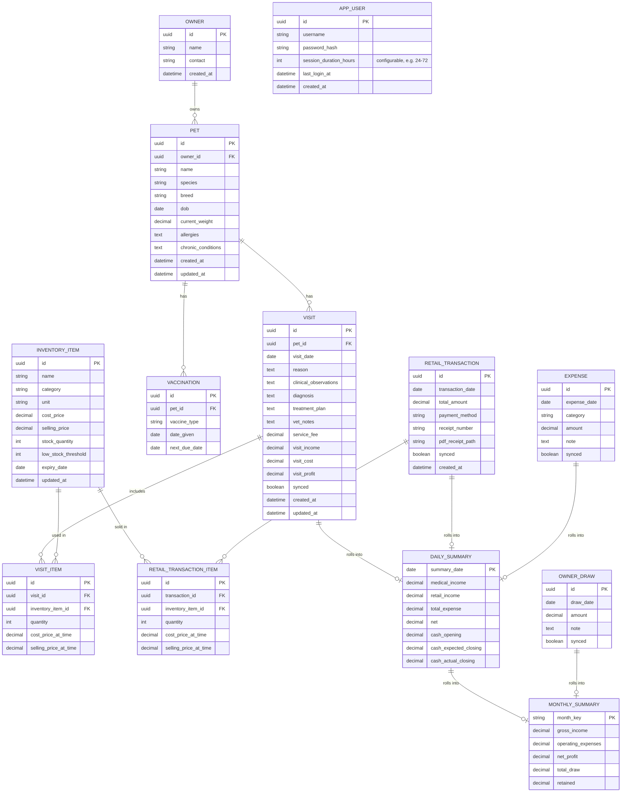
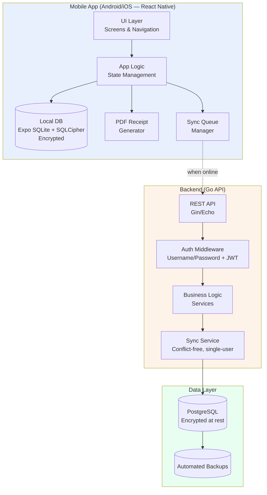
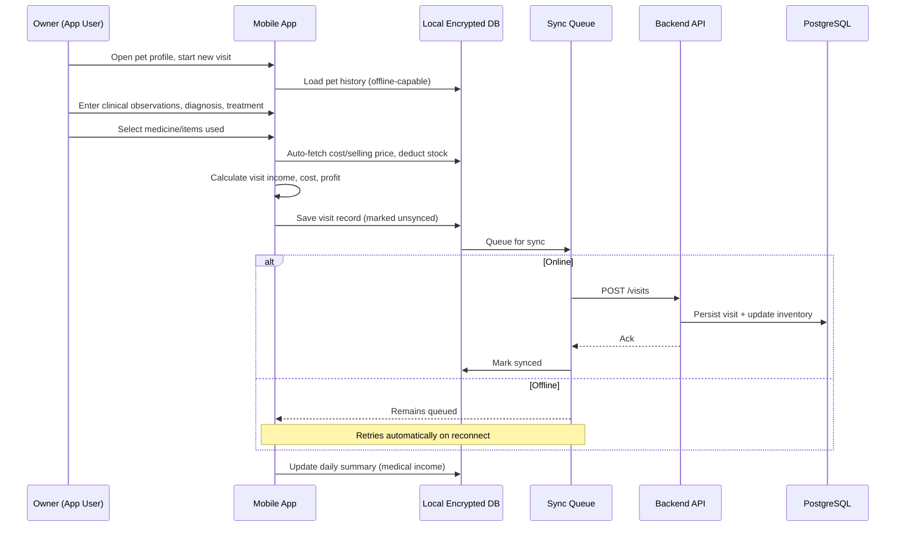
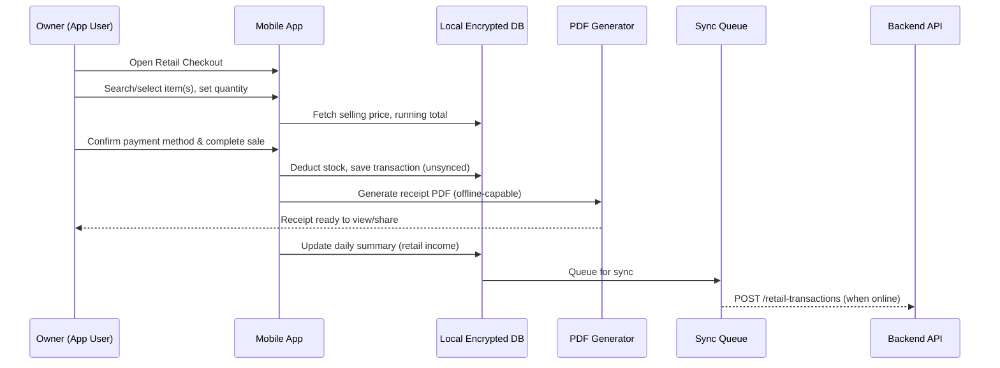
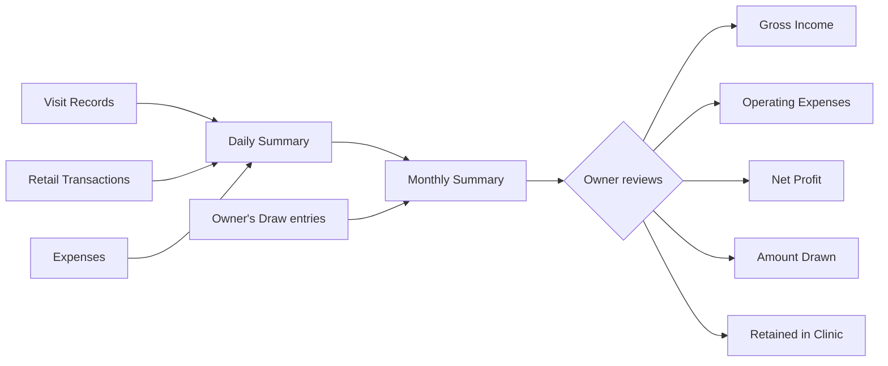

# Vet Clinic Management System — ERD & Architecture Flow

## 1. Entity Relationship Diagram (ERD)

**Notes on the ERD:**
- `VISIT_ITEM` and `RETAIL_TRANSACTION_ITEM` both snapshot `cost_price_at_time` / `selling_price_at_time` from `INVENTORY_ITEM` — so historical records stay accurate even if prices change later.
- `DAILY_SUMMARY` and `MONTHLY_SUMMARY` are **derived/computed** tables (materialized for fast reads), not manually entered — rebuilt from `VISIT`, `RETAIL_TRANSACTION`, `EXPENSE`, and `OWNER_DRAW` records.
- `synced` boolean fields exist on records created offline, to track what's pending upload to the backend.
- `PET` and `VISIT` include `updated_at` since both are editable after creation (correcting profile info, amending a diagnosis/notes) — `created_at` is preserved as the original record date, `updated_at` reflects the latest edit.
- `APP_USER` is a standalone entity (not connected by foreign key to clinic data) — it exists purely to gate login access. Since there's only one user and no roles/scopes, clinic records don't need a `user_id` ownership column; the account is provisioned manually (no self-registration flow) and simply controls whether the app can be opened at all.

---

## 2. System Architecture Flow

### 2.1 High-Level Architecture

### 2.2 Medical Visit Flow

### 2.3 Retail Transaction Flow (Fast Checkout)

### 2.4 Monthly Financial Rollup Flow

### 2.5 Offline-First Sync Strategy

- **Local-first writes**: every create/update (visit, retail transaction, expense, draw) writes to the local encrypted DB first, so the UI never blocks on network
- **Sync queue**: unsynced records are queued and pushed to the backend API in the background whenever connectivity is detected
- **Single-user simplification**: since there's only one user/device, there's no concurrent-edit conflict resolution needed — sync is a straightforward "push local changes, pull any backend-side derived data (e.g., recalculated summaries)"
- **Derived summaries**: daily/monthly summaries can be computed locally for immediate display, and recomputed/verified server-side once synced, as the source of truth
- **PDF receipts**: generated entirely on-device (no server dependency), so retail checkout speed is unaffected by connectivity

### 2.6 Security Layers

| Layer | Protection |
|---|---|
| App login | Required at launch — single, manually-provisioned account (username/password); no self-registration. Session token persists for a **configurable duration** (default ~1–3 days); supports offline login via securely cached credentials |
| Local storage | Encrypted local DB (e.g., SQLCipher) — no plaintext medical data at rest on device |
| Transport | TLS/HTTPS for all API calls |
| Backend storage | Encrypted PostgreSQL (at-rest encryption), access restricted to authenticated API |
| Backups | Automated, encrypted backups of the backend database |

---

## 3. Suggested Tech Stack (aligned with existing stack)

| Layer | Choice |
|---|---|
| Mobile framework | React Native via **Expo** (cross-platform Android/iOS, reuses React/TS knowledge) |
| Build/distribution | **Expo EAS Build** — compiles and signs iOS apps in the cloud, no Mac/Xcode required; distributes via TestFlight or direct install |
| Local DB | SQLite via Expo SQLite with SQLCipher |
| PDF generation | On-device library (e.g., `react-native-html-to-pdf` or `pdf-lib`) |
| Backend | Go (Gin or Echo framework) |
| Backend DB | PostgreSQL |
| Auth | Manually provisioned username/password login with JWT sessions |
| Hosting | Any standard cloud VM/managed Postgres — can stay minimal given single-user scale |

**Note on Expo + EAS**: Using Expo (rather than bare React Native) is recommended here specifically because of the no-Mac constraint — Expo's managed workflow plus EAS Build means iOS compilation, code signing, and even App Store/TestFlight submission all happen on Expo's cloud infrastructure. Local development and testing can still happen on Android freely; for iOS testing, builds are installed via TestFlight or Expo's development client on a physical/borrowed iPhone when needed.