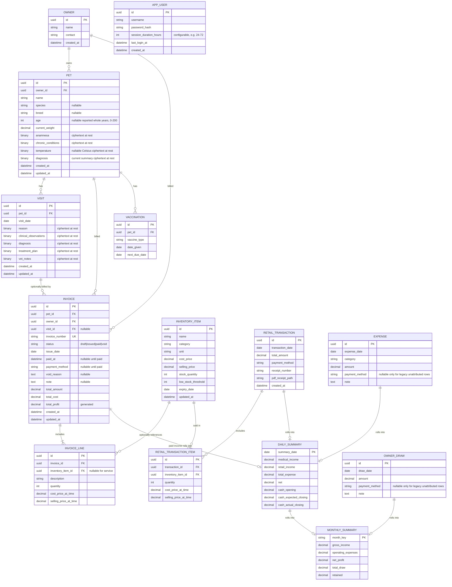
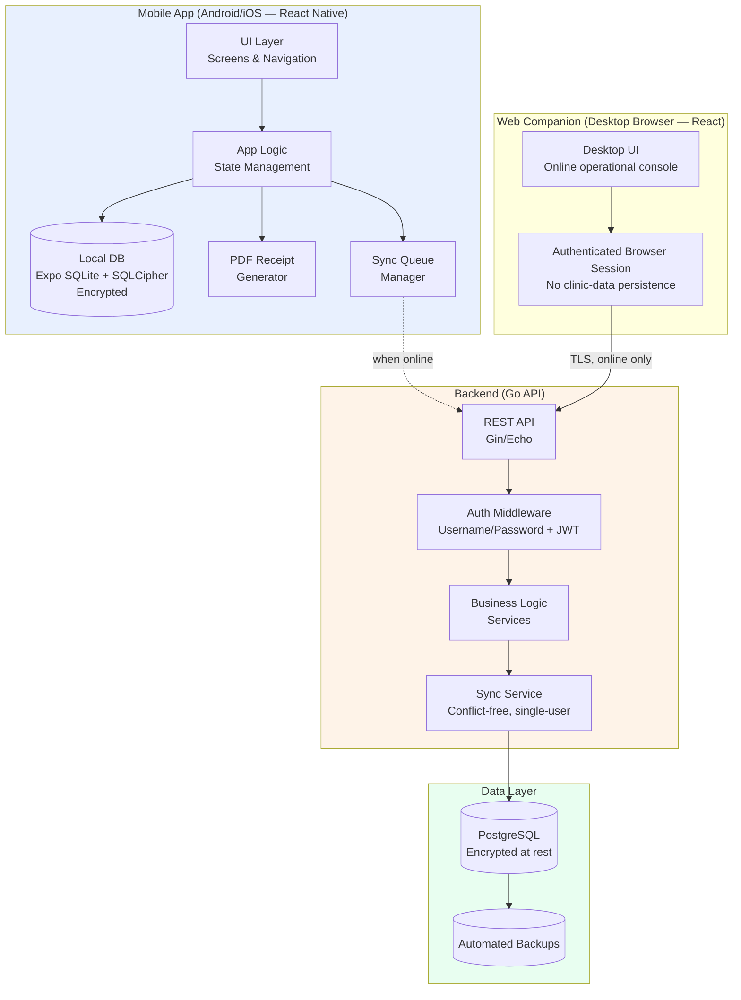
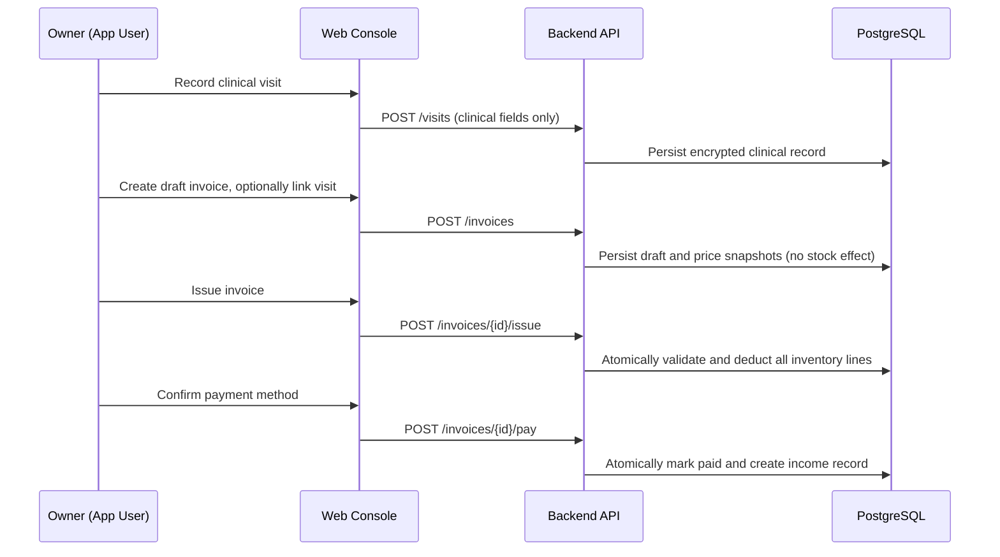
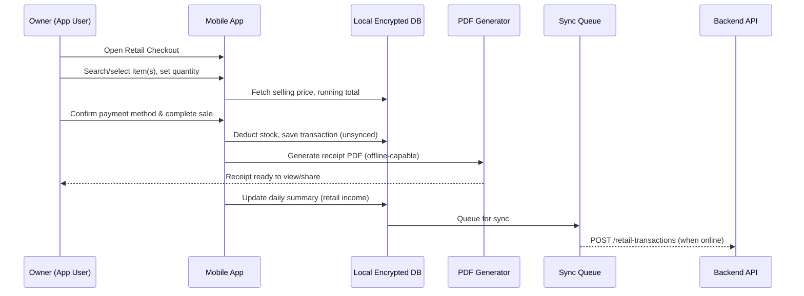
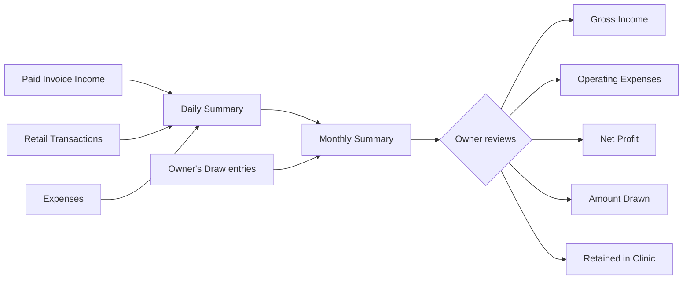

# Vet Clinic Management System — ERD & Architecture Flow

## 1. Entity Relationship Diagram (ERD)

**Notes on the ERD:**
- `INVOICE_LINE` and `RETAIL_TRANSACTION_ITEM` snapshot `cost_price_at_time` / `selling_price_at_time` from `INVENTORY_ITEM` — so historical records stay accurate even if prices change later. Service invoice lines have no inventory reference and always use zero cost.
- `VISIT` is clinical-only. It has no payment, item, stock, income, cost, or profit fields; an invoice may optionally link to one visit.
- Invoice stock effects occur only on state transitions: draft → issued deducts every inventory line atomically, and issued → void restores those quantities atomically. Paid invoices cannot be voided.
- Cash-affecting source records use the same constrained payment methods: `cash`, `qris`, `transfer`, or `card`. Paid invoices always have a method; expense and owner-draw rows may remain `NULL` only for legacy attribution gaps.
- `DAILY_SUMMARY` and `MONTHLY_SUMMARY` are **derived/computed projections**, not manually entered. The current backend computes them from paid invoice income records, `RETAIL_TRANSACTION`, `EXPENSE`, and `OWNER_DRAW` source records on demand. Invoice income is recognized on the clinic-local date of `paid_at`, never `issue_date`.
- Sync state belongs to the encrypted mobile outbox/checkpoint store, not authoritative PostgreSQL domain rows. The server-side operation ledger and checkpoint format remain part of the unfinished sync design.
- `PET` and `VISIT` include `updated_at` since both are editable after creation (correcting profile info, current clinical summary, or visit diagnosis/notes) — `created_at` is preserved as the original record date, `updated_at` reflects the latest edit.
- Pet `age` is a nullable reported whole-year value rather than a dynamically calculated age. Existing DOB values are preserved internally as `legacy_dob` during the compatibility period but are not exposed as current command fields.
- Pet `species` and `breed` may be unknown (`NULL`) but, when present, must be nonblank bounded strings.
- Pet `temperature` is a nullable current Celsius value from 20.0 through 50.0 with at most one decimal place. It is a current profile value, not a vitals-history ledger.
- Pet profile `diagnosis` is a manually maintained current summary; chronological encounter diagnoses remain on `VISIT` records.
- Medical fields shown as `binary` are plaintext only at authenticated application boundaries; PostgreSQL stores versioned authenticated-encryption envelopes in `BYTEA` columns as defined by ADR 0003.
- The logical `anamnesa` field retains the immutable cryptographic associated-data identifier `allergies` so ciphertext written before ADR 0009 remains decryptable. Database/API names and authenticated encryption field identities are intentionally decoupled for this field.
- `APP_USER` is a standalone entity (not connected by foreign key to clinic data) — it exists purely to gate login access. Since there's only one user and no roles/scopes, clinic records don't need a `user_id` ownership column; the account is provisioned manually (no self-registration flow) and simply controls whether the app can be opened at all.

---

## 2. System Architecture Flow

### 2.1 High-Level Architecture

### 2.2 Clinical Visit and Web Invoice Flow

### 2.3 Retail Transaction Flow (Fast Checkout)

### 2.4 Monthly Financial Rollup Flow

### 2.5 Offline-First Sync Strategy

- **Local-first writes**: every create/update (visit, retail transaction, expense, draw) writes to the local encrypted DB first, so the UI never blocks on network
- **Sync queue**: unsynced records are queued and pushed to the backend API in the background whenever connectivity is detected
- **Multi-client command policy**: ADR 0008 permits approved online web commands across domain services. Creates and append-only commands use client UUID idempotency; mutable updates use optimistic versions. A stale offline mobile operation remains queued after a server `409`, pulls current state, and requires operator resolution; it is never silently rebased or marked synced. Derived projections and append-only ledgers remain writable only through their owning commands.
- **Derived summaries**: daily/monthly summaries can be computed locally for immediate display, and recomputed/verified server-side once synced, as the source of truth
- **PDF receipts**: generated entirely on-device (no server dependency), so retail checkout speed is unaffected by connectivity

### 2.6 Security Layers

| Layer | Protection |
|---|---|
| App login | Required at launch — single, manually-provisioned account (username/password); no self-registration. Session token persists for a **configurable duration** (default ~1–3 days); supports offline login via securely cached credentials |
| Local storage | Encrypted local DB (e.g., SQLCipher) — no plaintext medical data at rest on device |
| Web browser | Authenticated before clinic data renders and online-only. ADR 0006 requires same-origin Secure/HttpOnly/SameSite session cookies, exact-origin and CSRF enforcement, no-store API responses, and no clinic records or tokens in `localStorage`/sessionStorage/IndexedDB/service-worker caches. Invoice POST/PUT transitions use the same CSRF-protected session boundary. |
| Transport | TLS/HTTPS for all API calls |
| Backend storage | Encrypted PostgreSQL (at-rest encryption), access restricted to authenticated API |
| Backups | Automated, encrypted backups of the backend database |

---

## 3. Suggested Tech Stack (aligned with existing stack)

| Layer | Choice |
|---|---|
| Mobile framework | React Native via **Expo** (cross-platform Android/iOS, reuses React/TS knowledge) |
| Web companion | React + TypeScript, desktop-first; separate `apps/web` client consuming the same OpenAPI contract |
| Build/distribution | **Expo EAS Build** — compiles and signs iOS apps in the cloud, no Mac/Xcode required; distributes via TestFlight or direct install |
| Local DB | SQLite via Expo SQLite with SQLCipher |
| PDF generation | On-device library (e.g., `react-native-html-to-pdf` or `pdf-lib`) |
| Backend | Go (Gin or Echo framework) |
| Backend DB | PostgreSQL |
| Auth | Manually provisioned username/password login with JWT sessions |
| Hosting | Any standard cloud VM/managed Postgres — can stay minimal given single-user scale |

**Note on Expo + EAS**: Using Expo (rather than bare React Native) is recommended here specifically because of the no-Mac constraint — Expo's managed workflow plus EAS Build means iOS compilation, code signing, and even App Store/TestFlight submission all happen on Expo's cloud infrastructure. Local development and testing can still happen on Android freely; for iOS testing, builds are installed via TestFlight or Expo's development client on a physical/borrowed iPhone when needed.